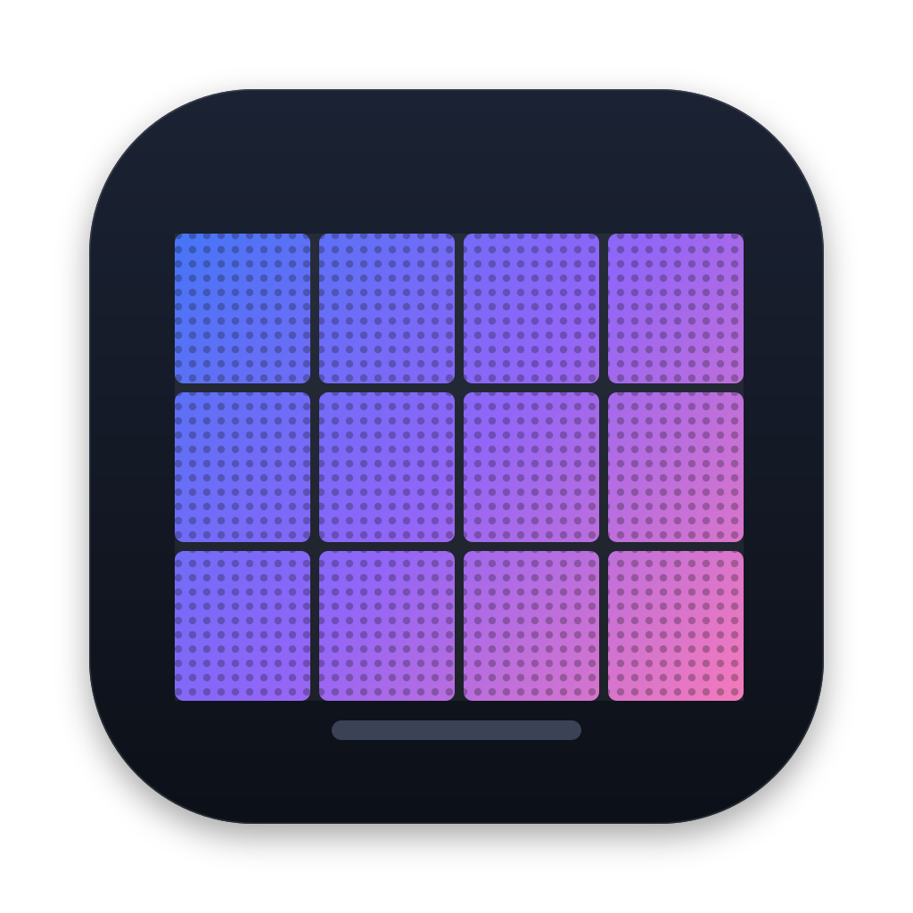

# NovaMac

A native macOS app (SwiftUI) for configuring and monitoring **NovaStar** LED display controllers — a Mac alternative to NovaLCT for everyday commissioning and service work.

> NovaMac is an independent project. It is not affiliated with or endorsed by NovaStar. "NovaStar", "NovaLCT", "VX" and "MCTRL" are trademarks of their owners. NovaMac contains no NovaLCT code: the protocol was worked out by observing traffic (Wireshark, USB serial), exported files and NovaStar's public "VX Pro Series Control Protocol" document.



## Status

Beta (version 0.2). Tested on real hardware:

| Controller | Link | Tested |
|---|---|---|
| VX1000 Pro | Ethernet (TCP 5200 + Unico web API, port 19999) | screens, layout send/save, brightness, gamma, test patterns, monitoring, device settings |
| MCTRL300 | USB (CP210x, 115200 8N1) | layout send/save, receiving cards, RCFGX, EDID, test patterns, monitoring |
| MEE410 | Ethernet (TCP 5200) | multi-port layout, receiving cards |

Receiving cards: XC160-1 (NovaStar A/XC series). Other models will probably work for the common features — please report what you find.

## Features

- **Dashboard** — every controller with power, receiving cards, temperature and input-signal indicators; Connect / Connected polling.
- **Screen Connection** — up to 10 screens, cabinets drawn and connected by clicking, free placement with magnet and grid, read from / send to / save to the controller (VX: registers + web model; MCTRL/MEE: register protocol), card numbers on the screen (mapping), **EDID** (custom input resolution) for MCTRL.
- **Receiving Cards** — read every parameter of any card, open / edit / send / save **RCFGX** configurations (one card or all), read a card back into an RCFGX file.
- **Brightness** — brightness, gamma, RGB gains, test patterns, black screen and freeze (MCTRL over registers, VX over its web interface).
- **Calibration** — calibration coefficients on/off, seam correction per module.
- **Monitoring** — card answer, temperature and voltage per cabinet, port load, alarms in the sidebar.
- **VX device settings** — name, network (IP / mask / gateway / DHCP), HDCP.
- **Agent API** — a local HTTP API (127.0.0.1 only) and an MCP server (`nova_mcp.py`) so AI agents such as Claude can read the screen state and, when allowed, fix it. See [AGENT-API.md](AGENT-API.md).
- Light and dark appearance, English / Русский / 简体中文.

## Install

1. Download `NovaMac-<version>.zip` from [Releases](https://github.com/maneak07/NovaMac/releases) and unzip it.
2. Move **NovaMac.app** to Applications.
3. The app is not signed with an Apple Developer ID yet, so the first time **right-click → Open → Open**. (Or: System Settings → Privacy & Security → "Open Anyway".)

Requirements: macOS 14 Sonoma or later (built and tested on macOS 27; older versions are expected to work but not yet tested on hardware), Apple silicon or Intel.

**USB controllers** (MCTRL…) use the CP210x USB-serial chip; current macOS has the driver built in.
**VX Pro** controllers: NovaMac logs in to the web interface with the factory account (admin / 123456) and asks for a password only if it was changed.

## Build from source

```bash
git clone https://github.com/maneak07/NovaMac.git
cd NovaMac
./tools/build-release.sh        # Release build + zip in build/, needs Xcode installed
```
Or open `NovaMac.xcodeproj` in Xcode 26 or later and press ⌘R. No third-party dependencies.

## AI agents

Enable **Agent API** in the app, copy the token, then add `nova_mcp.py` to your MCP client — details and the safe-fix procedure for receiving cards are in [AGENT-API.md](AGENT-API.md). Changes need "Allow changes" in the app, and every risky action returns a plan first and runs only after confirmation.

## Documentation

- [AGENT-API.md](AGENT-API.md) — local API and MCP tools
- [PROTOCOL-ScreenConnection.md](PROTOCOL-ScreenConnection.md) — protocol notes (register map found by observation)
- [HANDOFF.md](HANDOFF.md) — project state and open tasks
- `nova_bridge.py` — USB ↔ Parallels serial bridge with logging, for capturing what NovaLCT sends

## Feedback

Bugs, controller models that work or do not: [Issues](https://github.com/maneak07/NovaMac/issues).

## License

[MIT](LICENSE) © 2026 Mikhail Nosachev
